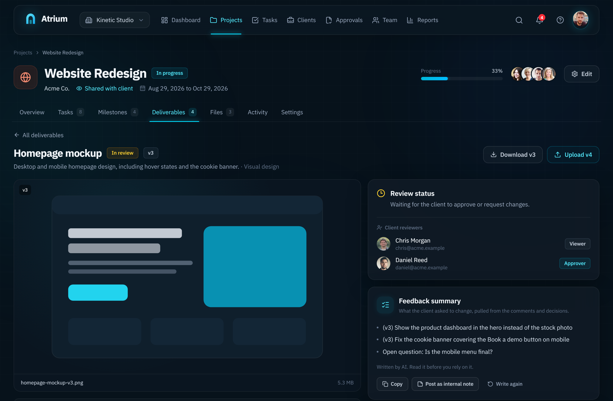
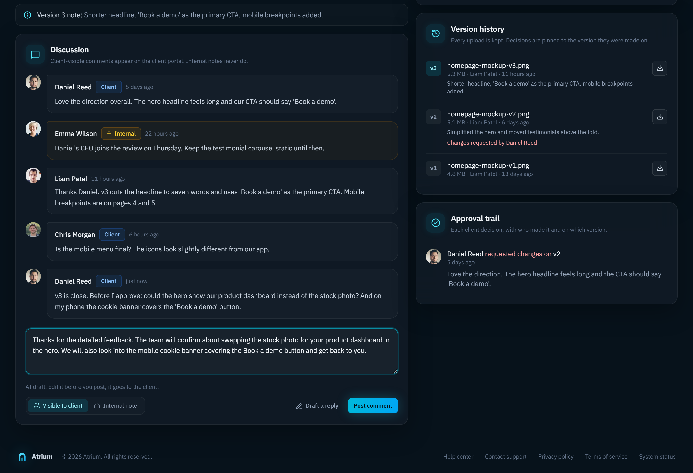
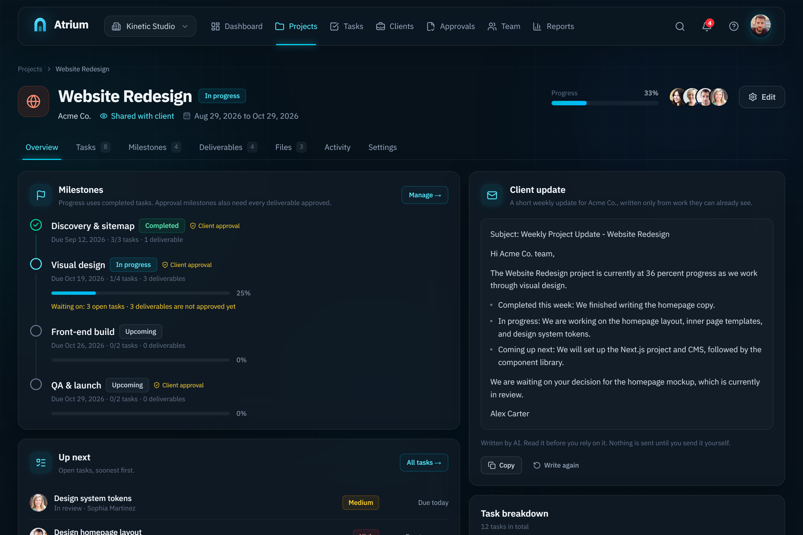
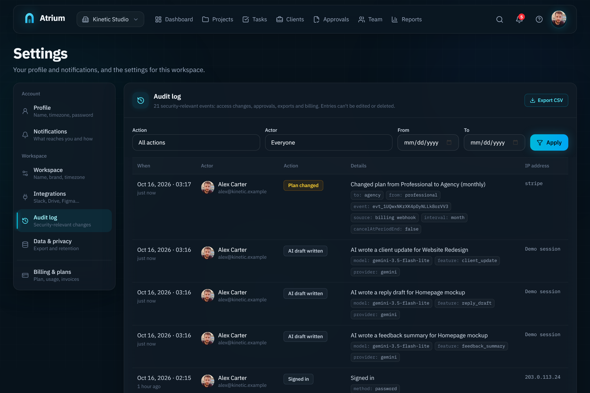
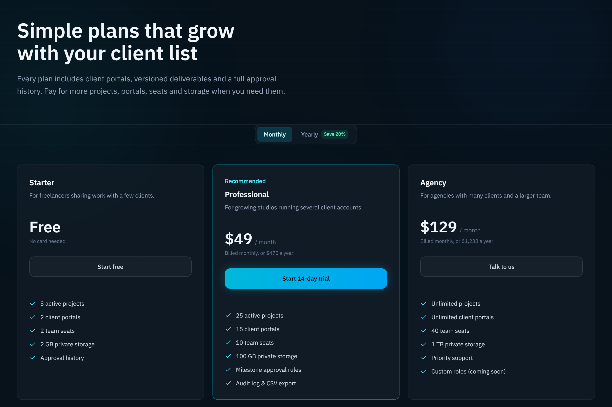
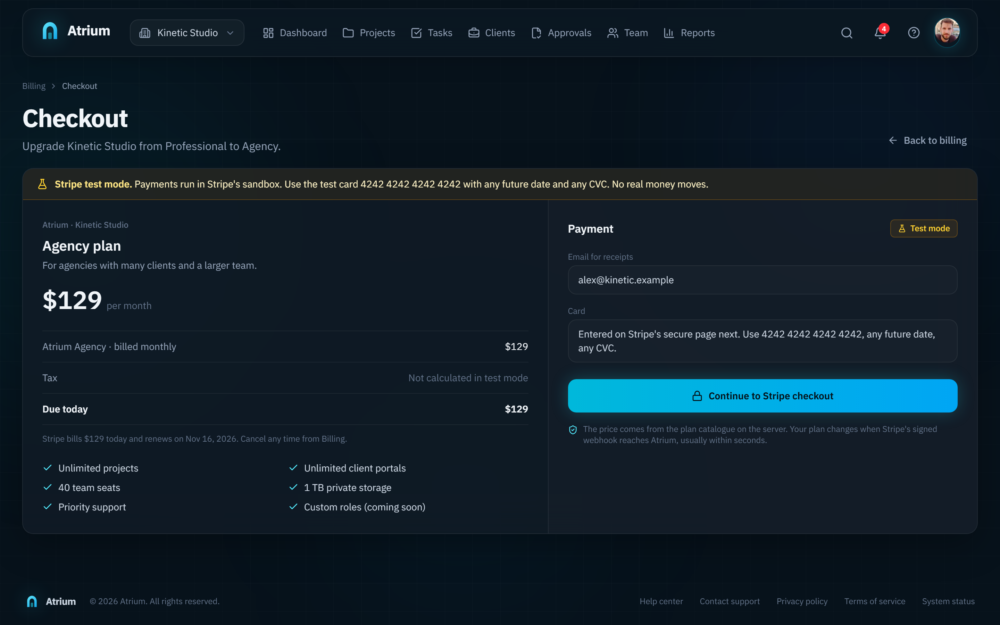
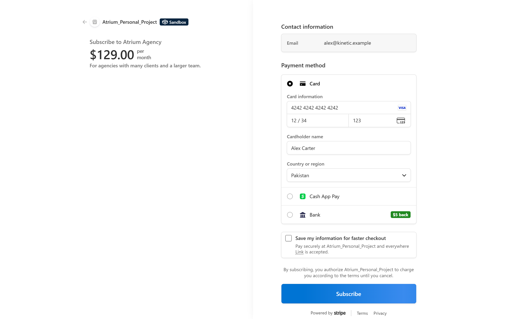
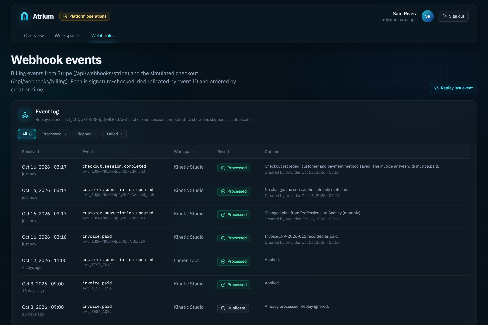
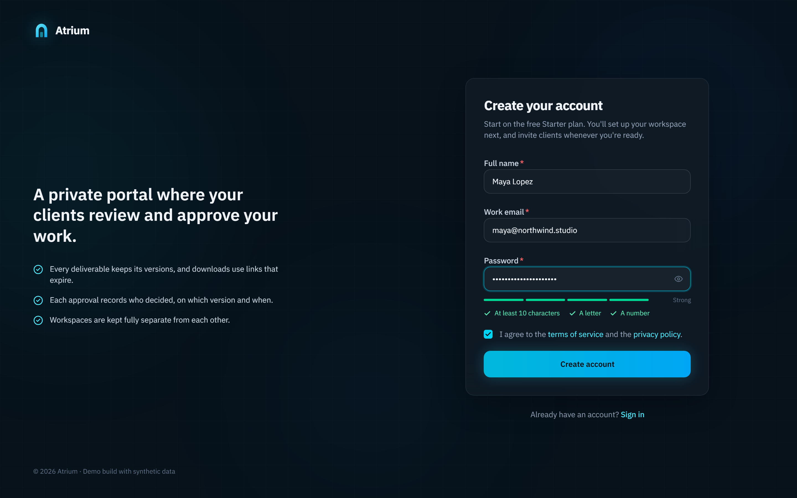
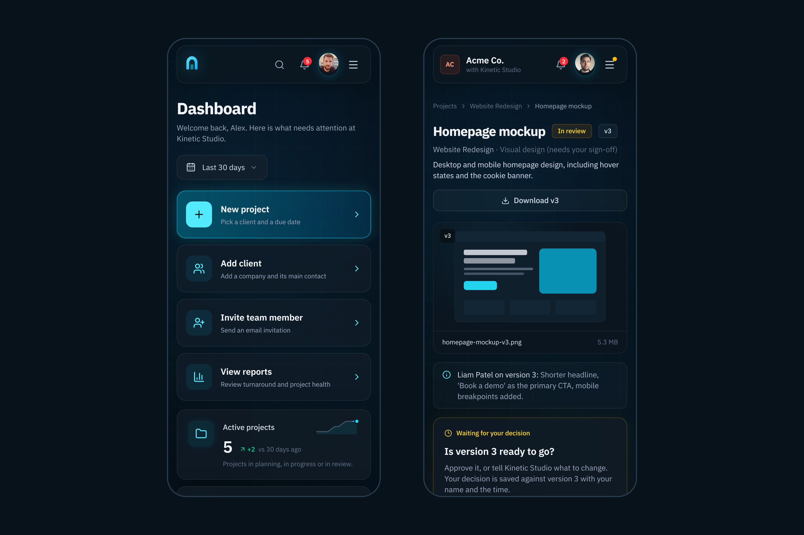

# Atrium

A multi-tenant client portal for agencies and studios. The team runs
projects, milestones and tasks in a private workspace; each client gets a
portal where they review versioned deliverables, comment, and approve or
request changes. Every decision is recorded against the exact version, with
who made it and when.

      


> **Status:** runs on Supabase (Postgres with row-level security, Auth,
> Storage and Realtime): uploads go straight to private storage, changes show
> up live in other open tabs, and people have profile photos. AI drafts
> (feedback summaries, replies, weekly client updates) run on Gemini's free
> tier or Claude, and plans are bought through Stripe Checkout in test mode.
> Without Supabase keys it falls back to an in-memory store with the same
> rules. Deployment is next; see
> [docs/roadmap.md](docs/roadmap.md). All data is synthetic.

## Screenshots

Taken from the app running on Supabase, with Gemini writing the drafts and
Stripe in a sandbox. Every person and company in them is made up. Click an
image for the full 2x size.

### AI drafts

The team gets three drafts: a summary of what the client asked for, a reply
to the client, and a weekly update for the client. A person reads and edits
each one; nothing reaches a client on its own. Drafts run on Gemini's free
tier, or on Claude when `ANTHROPIC_API_KEY` is set.

| Feedback summary on a deliverable | Reply draft in the comment box |
|---|---|
|  |  |
| **Weekly client update** | **Audit log: every AI call with its model and provider** |
|  |  |

Each draft gets only the material its reader may see: the reply and the
weekly update never contain internal notes, internal tasks, budgets or
unsent versions (tested in `tests/ai.test.ts`). What people wrote goes into
the prompt fenced and escaped as material, not instructions. Each workspace
gets 30 drafts a day and each person 15, counted from the audit log. When
one Gemini model is busy or over quota, the next one in the chain answers.
More in [docs/ai.md](docs/ai.md).

### Billing on Stripe (test mode)

| Pricing page | Checkout summary in Atrium |
|---|---|
|  |  |
| **Stripe Checkout with the test card** | **Back in Atrium once the webhook lands** |
|  |  |



Upgrades from a free plan go through Stripe Checkout. Switching paid plans
swaps the subscription's price and invoices the difference, cancelling
waits for the end of the paid period, and "Manage billing in Stripe" opens
the customer portal. The app never sets the plan itself in these flows.
`/api/webhooks/stripe` checks the `Stripe-Signature` header over the raw
body, accepts a price only if its lookup key, amount and interval match the
plan catalogue, skips event IDs it has already seen and ignores events older
than the stored state. Realtime then refreshes the open billing page. Live
keys are refused. More in [docs/stripe.md](docs/stripe.md).

### Sign up, client portal, board, phone

| Sign up | The client's review screen |
|---|---|
|  |  |
| **Task board** | **Phone layouts** |
|  |  |

A client only ever receives their own shared projects, client-visible tasks
and comments, and the versions they were sent. An approval is stored against
the exact version, with who decided and when; a stale tab can't approve an
older version.

## Try the demo

Run it locally (below), open `/login` and either click a demo account or
type its email with the password. Each account shows a different side of
the permission model.

**Password for every demo account: `atrium-demo`**

These are made-up demo people (the `.example` addresses can't receive
mail). Changes you make are wiped when the demo is reset.

The seven accounts with a button on the sign-in page:

| Email | Role | What you'll see |
|---|---|---|
| `alex@kinetic.example` | Agency owner, Kinetic Studio | Everything, plus a second workspace (Lumen Labs) in the switcher |
| `emma@kinetic.example` | Project manager | All projects and clients, invites, audit log, reports; no billing |
| `liam@kinetic.example` | Team member | Only the projects he's assigned to |
| `olivia@kinetic.example` | Billing manager | Plan, usage and invoices; no project data |
| `daniel@acme.example` | Client approver, Acme Co. | Acme Co.'s portal; can approve or request changes |
| `chris@acme.example` | Client viewer, Acme Co. | Same portal, comments only |
| `sam@atrium.example` | Platform operator | `/admin`: health, workspaces, webhook log |

More people in the demo (same password, sign in by typing the email):

| Email | Role |
|---|---|
| `sophia@kinetic.example` | Team member, Kinetic Studio |
| `noah@kinetic.example` | Team member, Kinetic Studio |
| `ethan@kinetic.example` | Team member, Kinetic Studio |
| `ava@kinetic.example` | Team member, Kinetic Studio |
| `priya@novatech.example` | Client approver, NovaTech (Kinetic Studio) |
| `marcus@pulse.example` | Client approver, Pulse Marketing (Kinetic Studio) |
| `hannah@shopease.example` | Client approver, ShopEase (Kinetic Studio) |
| `omar@brightpath.example` | Client approver, BrightPath (Kinetic Studio) |
| `maya@lumen.example` | Owner, Lumen Labs (the second workspace) |
| `leo@lumen.example` | Team member, Lumen Labs |
| `zara@orbit.example` | Client approver, Orbit Fintech (Lumen Labs) |

To see live updates, sign in as `alex@kinetic.example` in one browser and
`daniel@acme.example` in another (or a private window), open the same
deliverable and leave a comment.

You can also create your own account at `/signup`; it starts with an empty
workspace.

## What it does

**Team workspace**
- Dashboard with KPIs (active projects, tasks due soon, pending approvals,
  overdue tasks), each with a 12-week trend and a delta against a chosen
  period, all calculated from the data ([formulas](docs/business-rules.md)).
- Projects with milestones, client sharing, budget (internal) and team.
- Tasks as a board (drag and drop), list or calendar, across one project or
  all of them, with a task drawer and internal comments.
- Deliverables with full version history, private downloads through
  60-second signed links, a submit-for-review step and an approval trail.
- Comments that are either visible to the client or internal notes.
- Clients with portal users (approver or viewer), invitations and access
  revocation.
- Team management with role changes, seat limits and invitations.
- Approval queue, activity log, notifications, reports with documented
  formulas, settings (profile, workspace, notification preferences,
  integrations, audit log with CSV export, data export).
- Billing: plan comparison, usage meters, Stripe Checkout in test mode,
  plan switches with proration, cancel and resume, Stripe's customer
  portal, invoices. Without Stripe keys a simulated checkout runs instead.
  Either way, plan changes go through one signed, idempotent webhook
  processor.
- AI drafts: feedback summaries, client replies and weekly client updates,
  on Gemini or Claude.

**Client portal**
- Overview of what needs their review, project progress and recent updates.
- Review screen with version history, the agency's notes, approve or request
  changes, and the discussion.
- Approvals history, shared files and notifications.

**Platform operations**
- Health checks, platform metrics, workspace list with an audited
  metadata-only support view, webhook event log and replay.

## Security model

- The active workspace comes from a verified membership, never from request
  input alone. Every query and server action re-checks access and the
  tenant of every referenced id.
- Anything the viewer can't see renders as not found, so ids can't be probed.
- Client users only ever receive shared projects of their own client,
  client-visible tasks, submitted deliverables and client-visible comments,
  files and activity.
- Downloads are re-authorized, audited and issued as short-lived signed links.
- Uploads go straight to a private bucket through signed URLs; the saved row
  must match a signed ticket and an object of the reported size.
- Row-level security mirrors the access rules for everything the browser
  reads (Realtime); only the server writes.
- Approvals are idempotent per user and version; stale tabs can't approve an
  older version.
- Stripe webhooks must carry a valid `Stripe-Signature` (simulated ones an
  HMAC); events are deduplicated by id and ordered, and a plan only comes
  from a catalogue price whose amount matches.
- Plan limits are enforced on the server.

Details and the threat model: [docs/security.md](docs/security.md).

## Stack

Next.js 16 (App Router, Cache Components, server actions) · React 19 ·
TypeScript (strict) · Tailwind CSS 4 · Radix UI primitives · Supabase
(Postgres, Auth, Storage, Realtime) · Stripe (test mode) · Gemini or Claude
for AI drafts · zod · date-fns · Vitest · Playwright. One app, no separate API server
([why](docs/decisions/0001-single-nextjs-app-with-supabase.md)).

## Run it locally

Requirements: Node 24 and pnpm 10.

```bash
pnpm install
cp .env.example .env.local   # optional: without Supabase keys it runs in memory
pnpm dev                     # http://localhost:3000
```

With a Supabase project: fill in the Supabase variables, run
`supabase db push` and `pnpm seed` (details in
[docs/supabase.md](docs/supabase.md)).

| Command | What it does |
|---|---|
| `pnpm dev` | Development server |
| `pnpm build && pnpm start` | Production build and server (set `SESSION_SECRET`, or `ATRIUM_DEMO=true` for a demo deploy) |
| `pnpm lint` | ESLint |
| `pnpm typecheck` | Route type generation + `tsc --noEmit` |
| `pnpm test` | Unit tests (114): tenant isolation, roles, client boundaries, review state machine, KPI formulas, billing webhooks, CSV escaping, reports, upload tickets, photo checks, open-redirect guard, what AI drafts may see, Stripe event translation |
| `pnpm test:e2e` | Playwright against a production build in memory mode (30): sign-in, project and task creation, the client approval journey, cross-tenant and role checks, mobile layout |
| `pnpm test:e2e:supabase` | The same 30 tests against a server on Supabase (real Auth and Postgres; reset the demo before and after) |
| `pnpm seed` | Loads the demo users, photos and workspaces into Supabase |
| `pnpm stripe:setup` | Creates the Stripe test products, prices and customer portal |

On Supabase the demo resets with `pnpm seed`, from `/admin` → Reset demo
data, or on a schedule through `/api/cron/reset-demo`. In memory mode it
resets when the server restarts.

## Project structure

```
app/                 routes: (marketing), (auth), onboarding, w/[org], portal/[org], admin, api
components/ui        design system (cards, buttons, badges, forms, dialogs, tables, stat tiles)
components/*         feature components (shell, tasks, deliverables, portal, billing…)
lib/auth             session, permissions matrix, data-access entry points
lib/data             types, seed, store, access rules, read models, queries
lib/data/supabase    table map, request snapshot (load + diff save), demo seed
lib/storage          signed tickets, uploads, profile photos
lib/ai               AI provider adapter, prompts, what each draft may see, daily allowance
supabase/            schema migration (RLS, Realtime, buckets) and CLI config
lib/actions          server actions (validated, authorized, audited)
lib/domain           business rules and KPI formulas
lib/billing          plans, prices, usage, Stripe adapter, webhook processor
tests/  e2e/         Vitest and Playwright suites
docs/                architecture, data model, security, business rules, decisions, roadmap
```

## Documentation

- [Architecture](docs/architecture.md)
- [Data model](docs/data-model.md)
- [Business rules and KPI formulas](docs/business-rules.md)
- [Security and threat model](docs/security.md)
- [Supabase setup and data layer](docs/supabase.md)
- [AI drafts](docs/ai.md)
- [Stripe test mode](docs/stripe.md)
- [Decision records](docs/decisions/)
- [Roadmap](docs/roadmap.md)
- [Engineering conventions](docs/CONVENTIONS.md)
